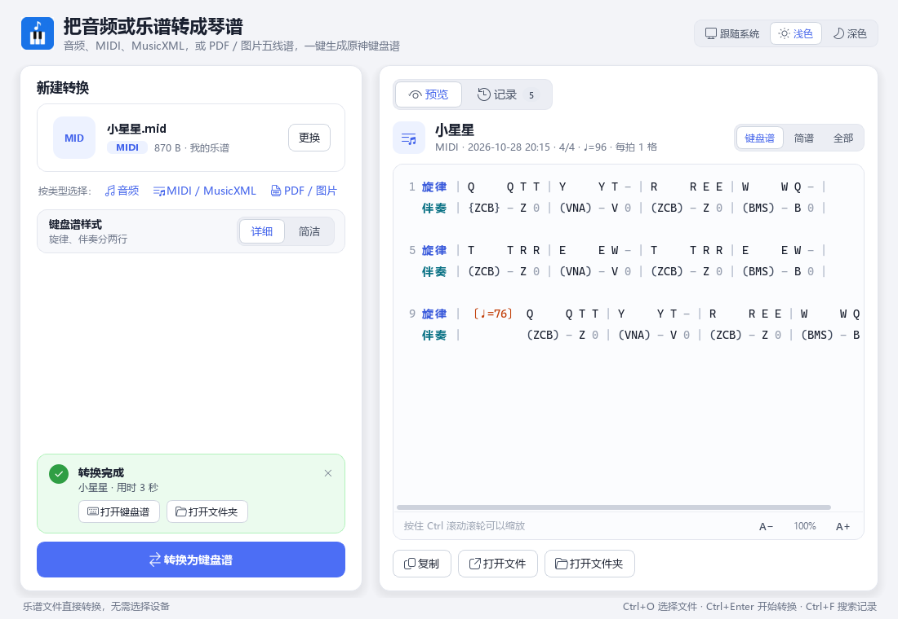

<div align="center">

# PianoConvert

**把歌曲、MIDI 和五线谱变成《原神》风物之诗琴可以直接弹的键盘谱**

Windows 桌面程序 · 中文界面 · 本地运行

**1.0.0 Beta**：[下载预发布版](https://github.com/NotBadSlime/PianoConvert/releases/tag/v1.0.0-beta.1) · [更新说明](docs/releases/1.0.0-beta.1.md)

[下载](https://github.com/NotBadSlime/PianoConvert/releases/latest) · [键盘谱记法](docs/键盘谱记法.md) · [常见问题](#常见问题) · [从源码运行](#从源码运行)

</div>

<p align="center">
  
  
</p>

## 功能

- **四种来源都能转**
  - 歌曲录音（mp3 / wav / flac / ogg / m4a）：用钢琴转录模型或通用模型转成 MIDI、MusicXML 和键盘谱
  - MIDI、MusicXML（mid / midi / musicxml / xml / mxl）：直接排成键盘谱
  - 打谱软件导出的五线谱 PDF：直接读取谱面上的音符、休止符、升降号、连音线、反复记号、琶音和倚音，速度快、基本不会认错
  - 扫描件、照片、截图（pdf / png / jpg）：用图像识别读五线谱或双手简谱
- **统一、易读的键盘谱**：小节线和小节号，每拍固定格数，和弦、琶音、倚音、延长、休止、拍号和速度变化都有固定写法；简谱和键盘谱一格对一格
- **两种样式**：「详细」把旋律和伴奏分成上下两行，按不过来时可以先只弹旋律；「简洁」写在一行
- **自动适配诗琴**：别的调整首移到 C 调，黑键改到相邻的白键，超出 C3–B5 的音按八度挪进来；做过哪些处理都写在谱头
- **顺手的界面**：拖入文件即可转换，内置键盘谱预览和一键复制，转换记录可搜索，支持浅色 / 深色主题，配备简洁钢琴图标与温迪主题背景
- **可选 GPU 加速**：有 NVIDIA 显卡时，在程序里下载 GPU 组件后，歌曲转录快很多

## 下载安装

1. 到 [Releases](https://github.com/NotBadSlime/PianoConvert/releases/latest) 下载最新的 `PianoConvertSetup-<版本>.exe`。
2. 运行安装包，按提示完成安装。
3. 从开始菜单或桌面打开 **PianoConvert**。

系统要求：64 位 Windows 10 / 11。转歌曲、MIDI、MusicXML 和打谱软件导出的 PDF 都不用联网；第一次用图像识别读扫描件或截图时，需要联网下载识别模型。

## 快速上手

1. 把文件拖进窗口，或点击选择文件（`Ctrl+O`）。
2. 如果是歌曲录音，选择乐器类型（钢琴 / 其他乐器）和计算设备（CPU / GPU）。
3. 选择键盘谱样式（详细 / 简洁）和音域处理方式，点 **开始转换**（`Ctrl+Enter`）。转换中可以随时取消。需要的话，展开 **高级选项** 调整琶音写法和和弦判定。
4. 转完后在右侧预览键盘谱，可以直接复制，或者打开文件、打开所在文件夹。

每次转换的结果放在 `文档\PianoConvert\Output\<歌名>_<日期时间>\`，包括键盘谱 `<歌名>_键盘谱.txt`，以及 MIDI、MusicXML（视来源而定）。以前的转换都在右侧「记录」里，可以搜索、预览和重新打开。

## 键盘谱长什么样

```text
# 小星星（示例）
# 1=C  4/4  ♩=120  每拍 1 格（一格 = 四分音符）  原神风物之诗琴 C3–B5 三排白键

【键盘谱】
1 旋律 | Q     Q T T | Y Y T - | R R wE E | W W Q - |
  伴奏 | {ZCB} - 0 C | V - Z - | X 0 Z  - | B - Z - |
```

| 记号 | 意思 |
|---|---|
| `Z X C V B N M` / `A S D F G H J` / `Q W E R T Y U` | 低音 / 中音 / 高音的 1–7（诗琴的三排键） |
| `\|` | 小节线；每行开头的数字是小节号 |
| 空格 | 分开每一拍；一拍里的格子紧挨着写，每拍格数整首不变 |
| `(ADG)` | 一起按 |
| `{ZCB}` | 琶音：从低到高依次快速按 |
| `wE` | 倚音：先快速带一下 W，再按 E |
| `-` | 前面的音还在响 |
| `0` | 不响（休止） |
| `〔3/4〕` `〔♩=60〕` | 从这一小节起改拍号、改速度 |

键盘谱文件包含一格对一格的【简谱】、新版【键盘谱】，以及附在末尾的旧版格式【指尖键盘谱】。完整说明见 [键盘谱记法](docs/键盘谱记法.md)。

## 识别效果

| 来源 | 效果 |
|---|---|
| MIDI、MusicXML | 音符原样读取，按诗琴音域和键位排版 |
| 打谱软件导出的 PDF | 直接读取谱面，反复记号和一二房子会展开，基本不会认错 |
| 歌曲录音 | 钢琴独奏录音效果最好；人声、伴奏很重的歌会有杂音和漏音 |
| 扫描件、照片、截图 | 图像识别，会有认错的地方，弹之前请对照原谱；不展开反复记号 |
| 吉他谱、手写谱 | 不支持 |

## 常见问题

**键盘谱和原曲不是一个调？**
C 大调和 A 小调的曲子不会移调。别的调会整首移到 C 调白键，因为诗琴只有白键；谱头的「处理」一行会写移了几个半音。

**`-` 要一直按住吗？**
不用。风物之诗琴按下就响，按住也不会更长。`-` 和 `0` 告诉你乐句怎么走：`-` 是音还连着，`0` 是该停的地方。换成能按住延长的乐器时，`-` 就是要按住的格子。

**和弦太多按不过来？**
用「详细」样式，先只弹上面「旋律」那一行，熟了再加伴奏。

**音域处理怎么选？**
默认使用新版逐音八度折叠：每个音独立移进 C3–B5。也可以选择旧版智能乐句移调，尽量保持旋律和弦的整体八度。两种方式都会把黑键改成相邻白键，选择会被记住；生成谱头会写入本次处理的移调、改键和折叠统计。

**琶音 `{ }` 不好弹，或者想照原样一个个弹？**
在 **高级选项 → 琶音写法** 里选「一起按」（写成 `( )`）或「分开写」（MIDI 里弹出来的琶音按先后分格）。

**演奏录的 MIDI、歌曲录音里，同一个和弦被拆成好几格？**
在 **高级选项 → 和弦判定** 里选「宽松」（相差 80 毫秒内算一起按）；反过来想拆得更细就选「严格」（30 毫秒）。

改了键盘谱样式、音域处理或高级选项后，右侧正在预览的键盘谱会立刻按新设置重新排版，不用重新转换；软件也会记住你的选择。

**谱头写着 ♩=90「只是默认值」？**
这份 PDF 上没有印速度，软件用了默认的每分钟 90 拍，可以按自己的感觉调整快慢。

**转歌曲很慢？**
窗口底部写着「使用 CPU」时，有 NVIDIA 显卡可以切换到 GPU，并按提示下载 GPU 组件（约 2.3 GB，可中途取消、下次接着下）。

**PDF 没认出来？**
先确认 PDF 里是印刷的五线谱或双手简谱。扫描件尽量清晰、端正，截图宽度最好在 1200 像素以上。

## 从源码运行

需要 Python 3.10（64 位）和 PowerShell。

```powershell
git clone https://github.com/NotBadSlime/PianoConvert.git
cd PianoConvert
py -3.10 -m venv .venv
.venv\Scripts\python -m pip install -r requirements.txt

# 读取 PDF / 图片乐谱需要的组件
.venv\Scripts\python -m pip install --ignore-requires-python --no-deps homr==0.7.0
.venv\Scripts\python -m pip install musicxml==1.4 "opencv-python-headless>=4.10,<4.13" "pypdfium2>=4,<6" "rapidocr>=3.7,<4"

# 钢琴转录模型（约 165 MB）
.\scripts\download_model.ps1 -Output "models\note_F1=0.9677_pedal_F1=0.9186.pth"

# 启动
.venv\Scripts\python -m app
```

运行测试：

```powershell
.venv\Scripts\python -m pytest -q
```

打包：

```powershell
.\scripts\build_exe.ps1                       # PyInstaller，输出到 dist\
.\scripts\build_installer.ps1 -Version 1.0.0  # Inno Setup 6 安装包，输出到 installer\output\
```

推送 `v*` 标签后，GitHub Actions 会自动测试、打包，并把安装包发布到 Releases。

## 项目结构

```text
app/
  ui/                界面（PySide6）
  engines/           歌曲转录引擎（钢琴模型、Basic Pitch）
  convert.py         转换流程
  keyboard_score.py  键盘谱排版
  pdf_vector.py      读取打谱软件导出的 PDF
  pdf_omr.py         扫描件 / 图片识别
  jianpu.py          简谱识别
piano_transcription_inference/   钢琴转录推理代码
scripts/             下载模型、打包、安装 GPU 组件
installer/           Inno Setup 安装脚本
docs/                说明文档
tests/               自动化测试
```

## 致谢与第三方组件

PianoConvert 使用了这些开源项目（版权和许可证归各自作者所有）：

| 项目 | 用途 | 许可证 |
|---|---|---|
| [piano_transcription_inference](https://github.com/qiuqiangkong/piano_transcription_inference) | 钢琴录音转录 | 见原项目 |
| [Basic Pitch](https://github.com/spotify/basic-pitch) | 其他乐器录音转录 | Apache-2.0 |
| [homr](https://github.com/liebharc/homr) | 扫描件、图片五线谱识别 | AGPL-3.0 |
| [RapidOCR](https://github.com/RapidAI/RapidOCR) | 简谱识别中的文字识别 | Apache-2.0 |
| [music21](https://github.com/cuthbertLab/music21) | MusicXML 读写 | BSD-3-Clause |
| [pretty_midi](https://github.com/craffel/pretty-midi)、[mido](https://github.com/mido/mido) | MIDI 读写 | MIT |
| [pypdfium2](https://github.com/pypdfium2-team/pypdfium2) | 读取 PDF | Apache-2.0 / BSD-3-Clause |
| [PySide6](https://doc.qt.io/qtforpython-6/) | 界面 | LGPL-3.0 |
| [PyTorch](https://pytorch.org/)、[ONNX Runtime](https://onnxruntime.ai/)、[librosa](https://librosa.org/)、[OpenCV](https://opencv.org/) | 推理和音频、图像处理 | BSD-3-Clause / MIT / ISC / Apache-2.0 |

安装包内含 homr（AGPL-3.0），其识别模型的训练数据有非商业使用条款，商用前请自行确认相关许可。

《原神》及风物之诗琴是 miHoYo 的商标和游戏内容，本项目与其没有关联。
